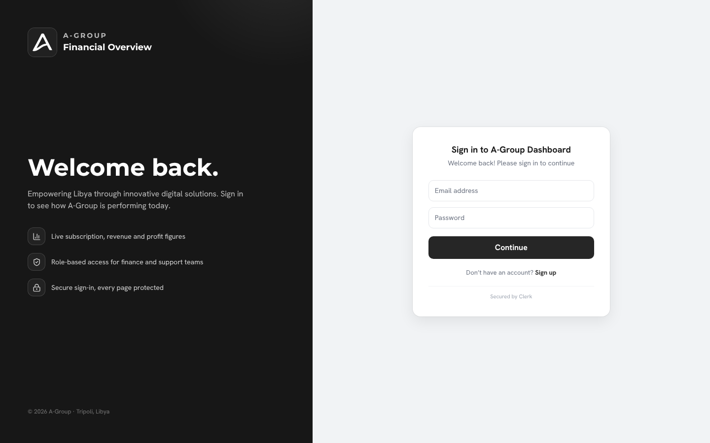
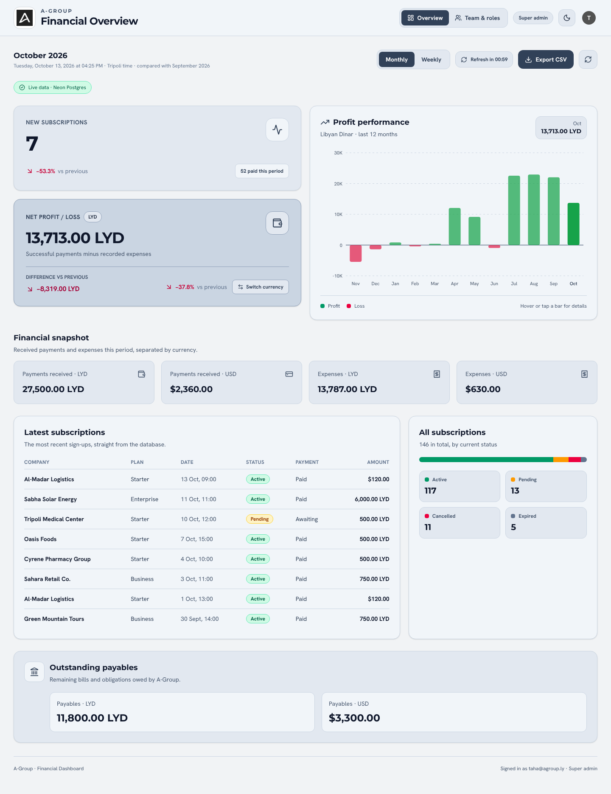
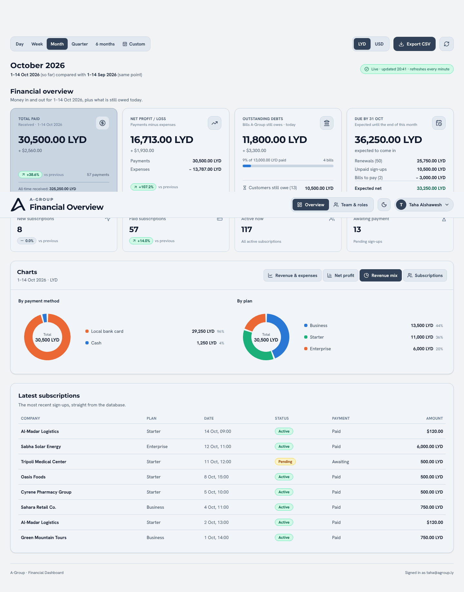
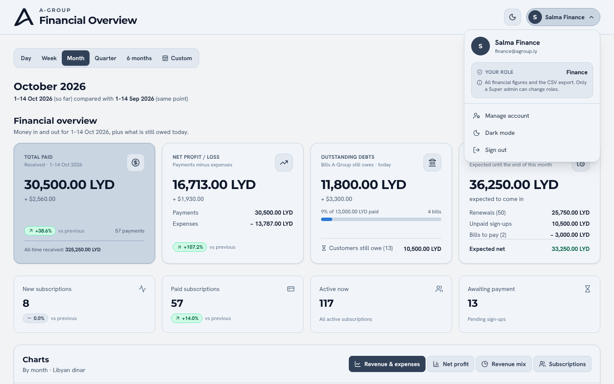
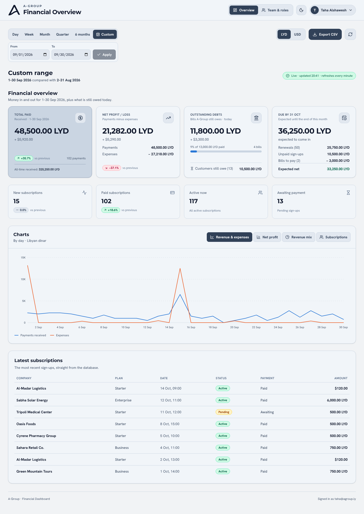
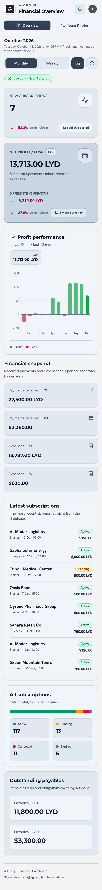
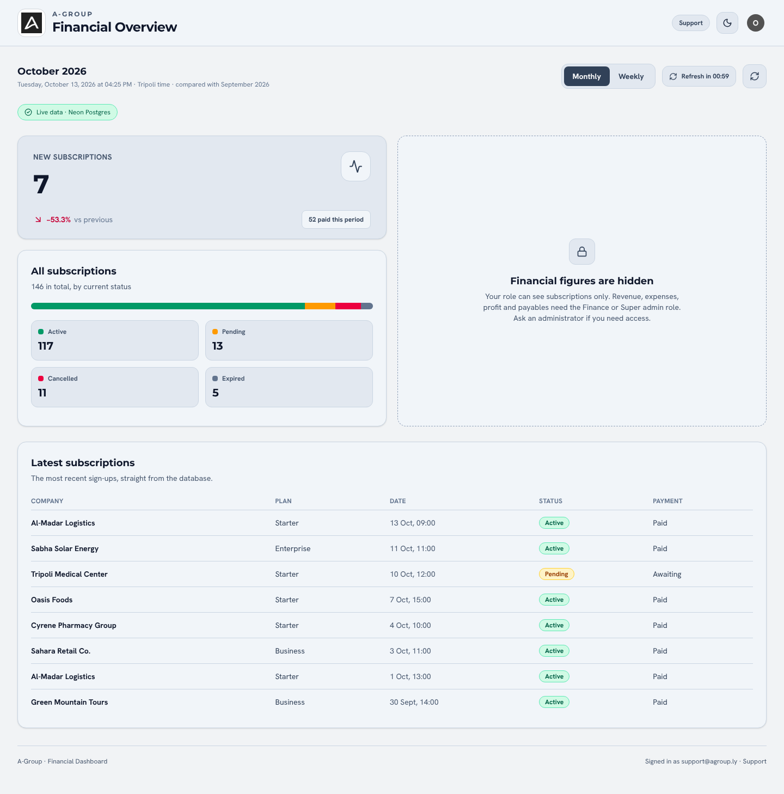
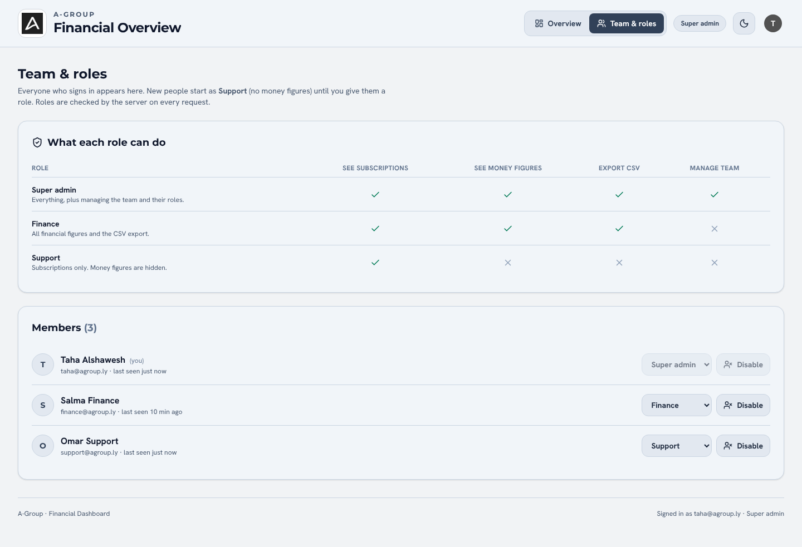

# A-Group Financial Dashboard

The A-Group dashboard brings subscription activity and financial summaries into one place. Sign in to review subscriptions, payments, expenses, profit and loss, and outstanding payables.

**Live website:** [Open the A-Group dashboard](https://agroup-dashboard.agroup-dashboard-ly-2026.workers.dev)

> The database currently contains sample data for demonstration. It is not A-Group's actual financial record.

## Screenshots

| Sign in | Dashboard |
| --- | --- |
|  |  |

| Charts (revenue mix) | Account menu with role | Custom date range |
| --- | --- | --- |
|  |  |  |

| Mobile layout | Support view | Team and roles |
| --- | --- | --- |
|  |  |  |

## What it includes

- **Financial overview first:** total paid, net profit/loss, outstanding debts (with how much is already paid), what customers still owe, and what is due by the end of the current month.
- **Date filters:** daily, weekly, monthly, quarterly, semiannual, and any custom date range.
- **Fair comparisons:** every range is compared with the equivalent previous period. A period that is still running is compared to the same point last time (1–14 Oct vs 1–14 Sep); a custom range is compared with the same number of days just before it.
- **Charts slideshow:** the charts rotate every 8 seconds with a progress bar. They pause while you point at them, while you use the keyboard there, for 12 seconds after a touch, and while the tab is hidden. You can also click a tab, use the arrow keys, or swipe on phones. Devices set to "reduce motion" do not auto-rotate.
- **Charts section** with tabs: revenue vs expenses (line), net profit (bar), revenue by payment method and by plan (pie), and subscriptions (bar + pie). Every chart has hover tooltips and works in both themes.
- Subscription, payment, expense, profit/loss, and payable figures from PostgreSQL.
- Separate LYD and USD totals; currencies are not added together.
- Light and dark themes, plus a layout that adapts to phone screens.
- Clerk sign-in and server-side checks for protected API routes.
- Three roles: **Super Admin**, **Finance**, and **Support**.
- A team page where Super Admins can change roles or disable access.
- The account menu (top right) shows your name, email and role as information, plus account settings, theme and sign out.

## Performance

- One SQL query per dashboard load (one round trip to Neon), started in parallel with the role check.
- No re-render every second: the old live clock and countdown were replaced by a timer that refreshes once a minute, and pauses while the browser tab is hidden.
- Results are cached per filter, so switching back to a range you already opened is instant.
- The Team page is loaded only when a Super admin opens it.
- Brand fonts were subset to Latin WOFF: about 110 KB instead of about 960 KB.
- Hand-written SVG charts, so no chart library is downloaded.
- `public/_headers` lets browsers cache hashed assets and fonts for a year.

## Roles

| Role | Subscriptions | Financial figures | CSV export | Manage team |
| --- | :---: | :---: | :---: | :---: |
| Super Admin | Yes | Yes | Yes | Yes |
| Finance | Yes | Yes | Yes | No |
| Support | Yes | No | No | No |

The API enforces permissions on the server. Hiding a menu item in the browser is not the security boundary.

## Technology

- **Frontend:** React, TypeScript, Vite, Tailwind CSS
- **API and hosting:** Cloudflare Workers
- **Database:** Neon PostgreSQL
- **Authentication:** Clerk
- **Checks and deployment workflow:** GitHub Actions

The Worker serves the built frontend and the `/api` endpoints from the same site. Financial summaries are calculated by the API from database records.

## Run it locally

You will need Node.js 22 or later, plus accounts for Neon and Clerk.

1. Clone the repository and install packages:

   ```bash
   npm install
   ```

2. Copy `.env.example` to `.env` and fill in the values for your Neon database and Clerk application. Keep `.env` private.

   On Windows PowerShell:

   ```powershell
   Copy-Item .env.example .env
   Copy-Item .env .dev.vars
   ```

3. Create the tables and load the sample records:

   ```bash
   npm run db:setup
   ```

4. Start the local app:

   ```bash
   npm run preview
   ```

   Open [http://localhost:8787](http://localhost:8787).

The sample records are intended for development and demos only.

## Useful commands

| Command | Purpose |
| --- | --- |
| `npm run check` | TypeScript check, lint, tests, and production build |
| `npm test` | Run the unit tests |
| `npm run db:setup` | Create database tables and load sample data |
| `npm run db:seed` | Reload sample data |
| `npm run deploy` | Build and deploy to Cloudflare Workers |

## Deploying

1. Sign in to Wrangler with `npx wrangler login`.
2. Add `DATABASE_URL`, `CLERK_SECRET_KEY`, `CLERK_PUBLISHABLE_KEY`, and `ADMIN_EMAILS` as Cloudflare Worker secrets.
3. Run `npm run deploy`.
4. Add the deployed domain to the Clerk application's allowed domains/settings as required.

For automated deployments, configure the repository secrets `CLOUDFLARE_API_TOKEN`, `CLOUDFLARE_ACCOUNT_ID`, and `VITE_CLERK_PUBLISHABLE_KEY`, plus the `PRODUCTION_URL` repository variable. The workflow in `.github/workflows/ci-cd.yml` runs checks on pull requests and is configured to deploy `main` when the required secrets are available.

## Security

- Do not commit `.env` or `.dev.vars`.
- Keep Clerk's secret key and the Neon connection string out of frontend code and GitHub.
- Protected API routes require a valid Clerk session and check the user's role on the server.
- Use the sample dataset for demonstrations; replace it with approved company data only when the database and access policy are ready.
