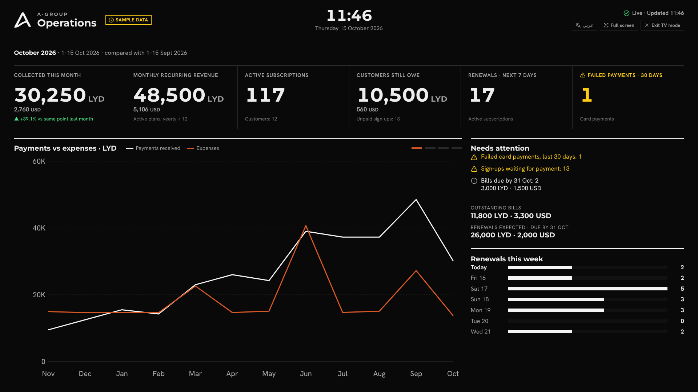
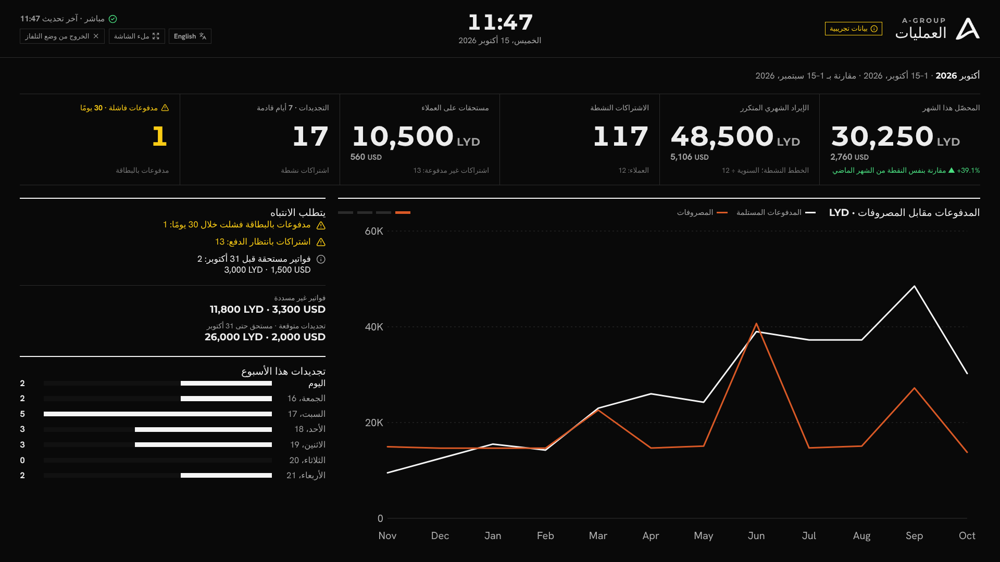

# A-Group Financial Dashboard

The A-Group dashboard brings subscription activity and financial summaries into one place. Sign in to review subscriptions, payments, expenses, profit and loss, and outstanding payables.

**Live website:** [Open the A-Group dashboard](https://agroup-dashboard.agroup-dashboard-ly-2026.workers.dev)

> The database currently contains sample data for demonstration. It is not A-Group's actual financial record.

## Screenshots

| Sign in | Dashboard |
| --- | --- |
|  |  |

| Charts (revenue mix) | Account menu with role | Custom date range |
| --- | --- | --- |
|  |  |  |

| Mobile layout | Support view | Team and roles |
| --- | --- | --- |
|  |  |  |

## What it includes

- **Financial overview first:** total paid, net profit/loss, outstanding debts (with how much is already paid), what customers still owe, and what is due by the end of the current month.
- **Date filters:** daily, weekly, monthly, quarterly, semiannual, and any custom date range.
- **Fair comparisons:** every range is compared with the equivalent previous period. A period that is still running is compared to the same point last time (1–14 Oct vs 1–14 Sep); a custom range is compared with the same number of days just before it.
- **TV mode:** a full-screen wallboard for office screens (see [TV mode](#tv-mode-wallboard)).
- **Charts slideshow:** the charts rotate every 8 seconds with a progress bar. They pause while you point at them, while you use the keyboard there, for 12 seconds after a touch, and while the tab is hidden. You can also click a tab, use the arrow keys, or swipe on phones. Devices set to "reduce motion" do not auto-rotate.
- **Charts section** with tabs: revenue vs expenses (line), net profit (bar), revenue by payment method and by plan (pie), and subscriptions (bar + pie). Every chart has hover tooltips and works in both themes.
- Subscription, payment, expense, profit/loss, and payable figures from PostgreSQL.
- Separate LYD and USD totals; currencies are not added together.
- Light and dark themes, plus a layout that adapts to phone screens.
- Clerk sign-in and server-side checks for protected API routes.
- Three roles: **Super Admin**, **Finance**, and **Support**.
- A team page where Super Admins can change roles or disable access.
- The account menu (top right) shows your name, email and role as information, plus account settings, theme and sign out.

## Performance

- One SQL query per dashboard load (one round trip to Neon), started in parallel with the role check.
- No re-render every second: the old live clock and countdown were replaced by a timer that refreshes once a minute, and pauses while the browser tab is hidden.
- Results are cached per filter, so switching back to a range you already opened is instant.
- The Team page is loaded only when a Super admin opens it.
- Brand fonts were subset to Latin WOFF: about 110 KB instead of about 960 KB.
- Hand-written SVG charts, so no chart library is downloaded.
- `public/_headers` lets browsers cache hashed assets and fonts for a year.

## TV mode (wallboard)

A full-screen board for an office TV or shared monitor. Open it with the **TV mode** button on the dashboard, or go to `/tv`.

| English | Arabic (right-to-left) |
| --- | --- |
|  |  |

**What it shows (aggregates only):**

| Figure | How it is calculated |
| --- | --- |
| Collected this month | Successful payments from the 1st of the month until now, LYD and USD separately, compared with the same point last month |
| Monthly recurring revenue (MRR) | Active subscriptions: monthly plans at their price + yearly plans ÷ 12, per currency |
| Active subscriptions / customers | Subscriptions with status ACTIVE; companies with at least one subscription |
| Customers still owe | Amount of PENDING subscriptions that have no successful payment |
| Renewals · next 7 days | Next billing date of active subscriptions, counted per day in Tripoli time |
| Failed payments · 30 days | Payments with status FAILED created in the last 30 days |
| Charts (rotate every 20 s) | Payments vs expenses per month (one slide per currency), new subscriptions per month, subscriptions by status |
| Needs attention | Counts of failed payments, unpaid sign-ups and bills due this month |

LYD and USD are always shown separately, never added. The **Sample data** badge appears automatically while the database still contains the demo records.

**Never shown on the TV:** customer names, emails, phone numbers, invoice ids or single transactions. The TV uses its own endpoint, `GET /api/wallboard`, which only returns totals and counts. It needs a signed-in user, and money figures are only included for the Finance and Super admin roles (checked on the server).

**Behaviour**

- Refreshes every 60 s, one request at a time. If the connection drops, the last figures stay on screen with a yellow **Connection lost** notice, retries back off (15 s → 5 min), and it recovers by itself. After 2.5 missed refreshes the status turns to **Data may be out of date**.
- **Full screen** button (browsers only allow it after a click). **Escape** or **Exit TV mode** returns to the dashboard; in full screen, Escape first leaves full screen.
- English / Arabic switch; Arabic uses right-to-left layout. Chart time axes stay left-to-right.
- Works at 1366×768, 1920×1080 and 4K without scrolling; on small screens it becomes a scrollable single column.
- The mouse pointer hides after 4 s without movement. With "reduce motion" turned on, charts do not rotate (choose them with the indicator buttons).
- Settings in the address: `/tv?refresh=60&dwell=20&lang=ar` (refresh 15–600 s, dwell 10–120 s).

**Setting up a shared office screen**

1. Create a dedicated Clerk account for the screen (for example `tv@your-company`).
2. Give it the **Support** role on Team & roles if visitors can see the screen (no money figures), or **Finance** if only staff can see it.
3. Sign in on the TV browser and open `/tv`. The session lasts as long as Clerk's session lifetime (Clerk → Sessions); sign in again when it expires.

A display-only link (no sign-in) is not implemented on purpose. It would need a revocable, narrowly scoped, expiring token, and should only be added after that design is approved.

**Known gaps:** there is no history of status changes, so an "active subscriptions over time" trend cannot be shown honestly; the board shows new subscriptions per month instead. "Collected vs outstanding" is not charted because receivables are not reconciled against payments per period.

## Roles

| Role | Subscriptions | Financial figures | CSV export | Manage team |
| --- | :---: | :---: | :---: | :---: |
| Super Admin | Yes | Yes | Yes | Yes |
| Finance | Yes | Yes | Yes | No |
| Support | Yes | No | No | No |

The API enforces permissions on the server. Hiding a menu item in the browser is not the security boundary.

## Technology

- **Frontend:** React, TypeScript, Vite, Tailwind CSS
- **API and hosting:** Cloudflare Workers
- **Database:** Neon PostgreSQL
- **Authentication:** Clerk
- **Checks and deployment workflow:** GitHub Actions

The Worker serves the built frontend and the `/api` endpoints from the same site. Financial summaries are calculated by the API from database records.

## Run it locally

You will need Node.js 22 or later, plus accounts for Neon and Clerk.

1. Clone the repository and install packages:

   ```bash
   npm install
   ```

2. Copy `.env.example` to `.env` and fill in the values for your Neon database and Clerk application. Keep `.env` private.

   On Windows PowerShell:

   ```powershell
   Copy-Item .env.example .env
   Copy-Item .env .dev.vars
   ```

3. Create the tables and load the sample records:

   ```bash
   npm run db:setup
   ```

4. Start the local app:

   ```bash
   npm run preview
   ```

   Open [http://localhost:8787](http://localhost:8787).

The sample records are intended for development and demos only.

## Useful commands

| Command | Purpose |
| --- | --- |
| `npm run check` | TypeScript check, lint, tests, and production build |
| `npm test` | Run the unit tests |
| `npm run db:setup` | Create database tables and load sample data |
| `npm run db:seed` | Reload sample data |
| `npm run deploy` | Build and deploy to Cloudflare Workers |

## Deploying

1. Sign in to Wrangler with `npx wrangler login`.
2. Add `DATABASE_URL`, `CLERK_SECRET_KEY`, `CLERK_PUBLISHABLE_KEY`, and `ADMIN_EMAILS` as Cloudflare Worker secrets.
3. Run `npm run deploy`.
4. Add the deployed domain to the Clerk application's allowed domains/settings as required.

### Automatic deployment (GitHub Actions)

Every pull request runs typecheck, lint, unit tests and a build. Every push to `main` (or **Actions → CI / CD → Run workflow**) runs the same checks, then:

1. **Checks the Cloudflare credentials** and stops with a plain-English error if the token is invalid, belongs to another account, or lacks the Workers permission. Stray spaces or line breaks in pasted secrets are removed automatically.
2. Deploys with `wrangler deploy`.
3. Smoke-tests the live site: `/api/health` must be up, `/api/config` must return the Clerk key, and `/api/me` must refuse anonymous visitors (401).

Only two repository secrets are needed:

| Secret | Where to get it |
| --- | --- |
| `CLOUDFLARE_API_TOKEN` | Cloudflare → My Profile → API Tokens → Create Token → template **Edit Cloudflare Workers** |
| `CLOUDFLARE_ACCOUNT_ID` | Cloudflare → Workers & Pages → Account ID (32 characters) |

The Clerk publishable key is **not** needed in GitHub: the page reads it at start-up from the worker (`/api/config`), which already has `CLERK_PUBLISHABLE_KEY` as a secret. Optionally set a `PRODUCTION_URL` repository variable if the site address changes.

## Security

- Do not commit `.env` or `.dev.vars`.
- Keep Clerk's secret key and the Neon connection string out of frontend code and GitHub.
- Protected API routes require a valid Clerk session and check the user's role on the server.
- Use the sample dataset for demonstrations; replace it with approved company data only when the database and access policy are ready.
